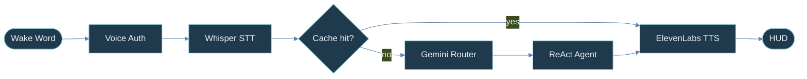

<div align="center">


[](https://git.io/typing-svg)


</div>

<br/>

<div align="center">


</div>

<table>
<tr>
<td width="55%" valign="top">

```yaml
name:      Aariyan Sunu
location:  Kerala, India
degree:    BTech CSE · 7th Sem · MITS · KTU
role:      Backend Engineer + AI Systems Builder
mindset:   "I think in systems, not websites."

currently:
  - Jarvis           # voice AI assistant
  - Emergency Sim    # real-time ambulance routing
  - ESP32 wearable   # hardware terminal for Jarvis
  - Pothole CV       # road-damage microservice

open_to:   internships · collabs
```

</td>
<td width="45%" align="center" valign="middle">


<br/>

```console
aariyan@mits:~$ uptime
 systems online · shipping steadily
```

</td>
</tr>
</table>

<br/>

<div align="center">


</div>

<table>
<tr>
<td colspan="2">

### 🎙️ &nbsp;Jarvis — Voice AI Assistant
<sub>&nbsp;&nbsp;&nbsp;&nbsp;&nbsp;&nbsp;Local-first voice OS replacing the keyboard entirely</sub>

</td>
</tr>
<tr>
<td width="58%" valign="top">



- Porcupine wake word + ECAPA-TDNN speaker verification
- Gemini 1.5 Flash intent router, sub-100ms on 50 cached commands
- ReAct multi-step agent, up to 5 chained planning steps
- Mood-based ElevenLabs TTS (happy / focused / tired)
- Iron Man–style HUD: radar, arc reactor, biometrics panels
- ESP32 wearable terminal over WiFi via ngrok + Flask

</td>
<td width="42%" valign="top" align="center">

<br/>


<br/><br/>


<br/>


<br/><br/>

[](https://github.com/Aariyan007/THEFriend)

</td>
</tr>
</table>

<table>
<tr>
<td width="33%" valign="top">

#### 🚑 Emergency Response Sim
<sub>Real-time ambulance routing + live ETA</sub>

- React + Leaflet live map
- WebSocket sync across all clients
- Online-learning ETA per dispatch
- Dynamic shortest-path routing
- Per-incident dispatch dashboard


</td>
<td width="33%" valign="top">

#### 🛣️ AI Pothole Detection
<sub>CV microservice for smart cities</sub>

- MobileNetV2 fine-tuned on road damage
- FastAPI, **< 200ms** per image
- Returns `{severity, confidence, bounding_region}`
- Batch inference support
- Drop-in for city pipelines


</td>
<td width="33%" valign="top">

#### 📡 Log Ingestion Platform
<sub>Observability stack from scratch</sub>

- npm-ready Node.js logger
- Full-text search across services
- Error-spike email alerting
- Multi-service log streams
- Filter by service / level / time


</td>
</tr>
</table>

<br/>

<div align="center">


<br/><br/>

<table>
<tr><td align="right"><sub><b>LANGUAGES</b></sub></td><td></td></tr>
<tr><td align="right"><sub><b>BACKEND</b></sub></td><td></td></tr>
<tr><td align="right"><sub><b>FRONTEND</b></sub></td><td></td></tr>
<tr><td align="right"><sub><b>DATA</b></sub></td><td></td></tr>
<tr><td align="right"><sub><b>AI / ML</b></sub></td><td> &nbsp;  </td></tr>
<tr><td align="right"><sub><b>TOOLS</b></sub></td><td> &nbsp; </td></tr>
</table>

</div>

<br/>

<div align="center">


<br/><br/>


</div>

<br/>

<div align="center">


<br/><br/>

<sub><b>JARVIS MODULES</b></sub>


<br/><br/>

<sub><b>ML ROADMAP</b></sub>


</div>

<br/>

<div align="center">

[](https://www.linkedin.com/in/aariyan-sunu)
[](mailto:aariyansunu28@gmail.com)
[](https://github.com/aariyan007)

[](https://git.io/typing-svg)


</div>
